<p align="center">
  
</p>

<p align="center">
  <strong>Your contact details, on a comms radio</strong>
</p>

<p align="center">
  <a href="https://nodejs.org/">
    
  </a>
  <a href="https://opensource.org/licenses/MIT">
    
  </a>
  
</p>

<h1>Open Comms</h1>

<p>Open Comms is a GitHub Action that turns the contact section of your profile README into a cockpit comms radio. Your email comes up on the station display, the COM 1 readout tunes in to its frequency, a data burst scrolls across the scope and the transmit lamp keys in bursts. Below it, a message display shows a status line you write yourself, such as <code>SYSTEMS NOMINAL · READY FOR NEXT MISSION</code>.</p>

<p>The output is a single animated SVG with no JavaScript, so it plays inside a plain <code>&lt;img&gt;</code> tag on your GitHub profile README. Wrap it in a <code>mailto:</code> link and the whole radio becomes the push-to-talk button. It uses the same phosphor-green palette as its sister projects <a href="https://github.com/maxhayim/flight-path-radar">Flight Path Radar</a>, <a href="https://github.com/maxhayim/cockpit-telemetry">Cockpit Telemetry</a> and <a href="https://github.com/maxhayim/systems-console">Systems Console</a>.</p>

<h2>Features</h2>

<ul>
  <li><strong>Comms panel:</strong> COM 1 frequency readout with standby and guard, VOL, SQL and FREQ knobs, a station display with your email, a scope, TX and RX lamps and a signal meter</li>
  <li><strong>Tune-in on load:</strong> the readout runs through a few channels and locks on, the knobs swing into place, and your email types itself out</li>
  <li><strong>Your own status line:</strong> any message on the status display through the <code>status</code> input, with a blinking cursor and a GO lamp</li>
  <li><strong>Synced with GitHub:</strong> set <code>github_status: true</code> and the display shows the status you set on your GitHub profile; mark yourself busy and the lamp turns to amber BUSY</li>
  <li><strong>Clickable:</strong> wrap the image in a <code>mailto:</code> link and the push-to-talk plate tells visitors to click to transmit; the SVG has the same link built in for when it's opened on its own</li>
  <li><strong>Two links:</strong> split it into the radio and the message panel with <code>?part=</code>, so the email opens a new message and the rest links to your project page</li>
  <li><strong>Everything optional:</strong> turn off the email for a receive-only radio, or the visitor log, for the whole run or one output</li>
  <li><strong>Visitor log:</strong> an optional odometer of your visitor count inside the panel, counted by a hidden 1×1 pixel in your README (see <a href="#visitor-counter">Visitor Counter</a>)</li>
  <li><strong>Optional titles:</strong> hide the header and panel titles with <code>titles: false</code> when your README has its own heading (see the <a href="#gallery">Gallery</a>)</li>
  <li><strong>Zero dependencies:</strong> plain Node.js, nothing to install</li>
  <li>Works with the built-in <code>GITHUB_TOKEN</code></li>
</ul>

<h2>Gallery</h2>

<p>Every example below is live output from this Action. Copy the setting under a preview into your workflow.</p>

<p><a href="#with-titles">With titles</a> · <a href="#without-titles">Without titles</a> · <a href="#custom-status">Custom status and frequency</a> · <a href="#receive-only">Receive only</a></p>

<h3 id="with-titles">With titles</h3>

<p>The default: a header with the <code>OPEN COMMS</code> title, your callsign and your name, and each panel's title and readout. This one shows the GitHub status (<code>github_status: true</code>) and the visitor log (<code>visitor_page_id: maxhayim.maxhayim</code>).</p>

<p align="center"></p>

<h3 id="without-titles">Without titles</h3>

<p>The header and the panel titles hidden. The panels move up to fill the space; the annunciator strip stays. Use <code>titles: false</code> or <code>?titles=false</code>. This one also has the visitor log: <code>visitor_page_id: maxhayim.maxhayim</code>.</p>

<p align="center"></p>

<h3 id="custom-status">Custom status and frequency</h3>

<p>Any message on the status display, and any frequency on the readout. Use <code>status: OPEN TO COLLABORATION · TRANSMIT ANY TIME</code> and <code>frequency: 121.5</code>.</p>

<p align="center"></p>

<h3 id="receive-only">Receive only</h3>

<p>No email: the station display listens, the transmitter goes dark and the push-to-talk plate reads RECEIVE ONLY. Leave <code>email</code> empty, set <code>email: false</code>, or add <code>?email=false</code> to one output. This one also has <code>visitor_log: false</code>.</p>

<p align="center"></p>

<h2>Requirements</h2>

<ul>
  <li>A GitHub profile repository (<code>&lt;you&gt;/&lt;you&gt;</code>) with Actions enabled</li>
  <li>Workflow permission <code>contents: write</code>, so the SVG can be pushed to an <code>output</code> branch</li>
  <li>Node.js 20 or newer, only if you run it locally (the Action sets Node up for you)</li>
</ul>

<h2>Installation and Setup</h2>

1. In your profile repository, create `.github/workflows/open-comms.yml`:

   ```yaml
   name: Open Comms

   on:
     schedule:
       - cron: "0 */12 * * *"   # every 12 hours
     workflow_dispatch:

   permissions:
     contents: write

   jobs:
     build:
       runs-on: ubuntu-latest
       steps:
         - uses: maxhayim/open-comms@v1
           with:
             github_user_name: ${{ github.repository_owner }}
             email: you@example.com
             status: SYSTEMS NOMINAL · READY FOR NEXT MISSION
             github_status: true
             visitor_page_id: ${{ github.repository_owner }}.${{ github.repository_owner }}
             outputs: dist/open-comms.svg

         - uses: crazy-max/ghaction-github-pages@v4
           with:
             target_branch: output
             build_dir: dist
           env:
             GITHUB_TOKEN: ${{ secrets.GITHUB_TOKEN }}
   ```

   Every line under `with:` except `github_user_name` is optional. Drop `visitor_page_id` (or set `visitor_log: false`) for no visitor log, and drop `email` for a receive-only radio.

   If you already publish another SVG to the `output` branch (for example with Flight Path Radar, Cockpit Telemetry or Systems Console), add the Open Comms step to that same job instead, so one publish step pushes them all.

2. Run the workflow once from the **Actions** tab (**Run workflow**), or wait for the schedule.

3. Add the image to your profile `README.md`, wrapped in a `mailto:` link. A link inside an SVG can't be clicked when it's shown through ``, so the link has to go around the image:

   ```html
   <a href="mailto:you@example.com">
     /<you>/output/open-comms.svg" alt="Open Comms: email me" width="100%">
   </a>
   ```

   With no email, leave out the `<a>` link and use the `` on its own.

   To have the email open a new message and the rest of the panel link somewhere else (your project, this repo), see [Two Links](#two-links).

<h2 id="two-links">Two Links</h2>

<p>A README image can carry only one link. To give the email its own link, draw the panel as two images and stack them: <code>?part=radio</code> draws the header and comms panel, <code>?part=status</code> draws the message panel and lamp strip. The corners where they meet are square, so they read as one console.</p>

<p align="center"><br></p>

```yaml
outputs: |
  dist/open-comms-radio.svg?part=radio&titles=false
  dist/open-comms-status.svg?part=status&titles=false
```

```html
<p align="center">
  <a href="mailto:you@example.com">/<you>/output/open-comms-radio.svg" alt="Open Comms: email me" width="100%"></a><br>
  <a href="https://github.com/maxhayim/open-comms">/<you>/output/open-comms-status.svg" alt="Open Comms status" width="100%"></a>
</p>
```

<h2 id="status-message">Status Message</h2>

<p>The message display shows <code>status</code>, which defaults to <code>SYSTEMS NOMINAL · READY FOR NEXT MISSION</code>. Change it in your workflow and it updates on the next run.</p>

<p>To change it without touching the workflow, set <code>github_status: true</code> and set your status on GitHub (your avatar, then <strong>Set status</strong>). The next run shows it in capitals, with emoji taken out and sentence breaks turned into <code>·</code>, so <code>Systems nominal. Ready for next mission.</code> becomes <code>SYSTEMS NOMINAL · READY FOR NEXT MISSION</code>. Tick <strong>Busy</strong> and the GO lamp becomes an amber BUSY lamp. Clear your GitHub status and the display goes back to <code>status</code>. The panel title reads <code>SYNCED FROM GITHUB</code> while it shows your GitHub status.</p>

<h2 id="visitor-counter">Visitor Counter</h2>

<p>Set <code>visitor_page_id</code> and the message panel gets a <code>VISITOR LOG</code> odometer, read from <a href="https://github.com/jwenjian/visitor-badge">visitor-badge</a> each time the workflow runs. Reading it doesn't add a visit. If the badge service doesn't answer, the odometer shows dashes and the run carries on.</p>

<p>The odometer can't count visits on its own: GitHub serves the SVG from a cache, so it never sees who views your profile. A visitor-badge image in your README records each visit. Make it a hidden 1×1 pixel so the odometer is the only counter on the page, and use the same <code>page_id</code> as <code>visitor_page_id</code>:</p>

```html
.<you>" width="1" height="1" alt="">
```

<p>The odometer shows the count from the last run, so run the workflow often. Every 5 minutes is the fastest GitHub allows (<code>cron: "*/5 * * * *"</code>); add GitHub's own image caching and the number on your profile is usually 5 to 15 minutes behind. Workflows are free for public repositories, but scheduled runs can be delayed when GitHub is busy.</p>

<p>If you'd rather show the exact live count as well, use a visible badge instead of the pixel. visitor-badge takes <code>left_text</code>, <code>left_color</code> and <code>right_color</code> (its text is always white), so dark cockpit greens match the panel:</p>

```html
<p align="center">
  .<you>&left_text=VISITOR%20LOG&left_color=%2303140b&right_color=%231c8443" alt="Visitor counter">
</p>
```

<p>If you already have a badge, keep its <code>page_id</code>; the count carries on. The badge service can be slow to respond, so a visible badge sometimes loads after the rest of the page.</p>

<h2>Usage</h2>

<h3>Inputs</h3>

<table>
  <tr><th>Input</th><th>Default</th><th>Description</th></tr>
  <tr><td><code>github_user_name</code></td><td>(required)</td><td>User whose callsign and name go in the header.</td></tr>
  <tr><td><code>email</code></td><td>(none)</td><td>Email address shown on the station display. Empty or <code>false</code> for a receive-only radio.</td></tr>
  <tr><td><code>status</code></td><td><code>SYSTEMS NOMINAL · READY FOR NEXT MISSION</code></td><td>Message shown on the status display. Shown in capitals.</td></tr>
  <tr><td><code>github_status</code></td><td><code>false</code></td><td>Set to <code>true</code> to show your GitHub profile status instead of <code>status</code> when you have one set.</td></tr>
  <tr><td><code>frequency</code></td><td><code>122.800</code></td><td>Active frequency on the COM 1 readout, in MHz.</td></tr>
  <tr><td><code>visitor_page_id</code></td><td>(none)</td><td>visitor-badge <code>page_id</code>. Adds a <code>VISITOR LOG</code> odometer with the count when the image was drawn.</td></tr>
  <tr><td><code>visitor_log</code></td><td><code>true</code></td><td>Set to <code>false</code> to hide the visitor log even when <code>visitor_page_id</code> is set.</td></tr>
  <tr><td><code>outputs</code></td><td><code>dist/open-comms.svg</code></td><td>One file per line. Add <code>?titles=false</code>, <code>?email=false</code>, <code>?visitor_log=false</code> or <code>?part=radio</code> / <code>?part=status</code> to change that file; join them with <code>&amp;</code>.</td></tr>
  <tr><td><code>titles</code></td><td><code>true</code></td><td>Set to <code>false</code> to hide the header (title, callsign, name) and the panel titles.</td></tr>
  <tr><td><code>github_token</code></td><td><code>github.token</code></td><td>Token used to read your name and status from the GitHub API.</td></tr>
</table>

<h3>Running Locally</h3>

<pre><code>git clone https://github.com/maxhayim/open-comms.git
cd open-comms
export GITHUB_TOKEN=$(gh auth token)
OPEN_COMMS_EMAIL=you@example.com node src/cli.mjs &lt;user&gt; out/open-comms.svg 'out/open-comms-no-titles.svg?titles=false'
OPEN_COMMS_EMAIL=you@example.com OPEN_COMMS_GITHUB_STATUS=true OPEN_COMMS_VISITOR_PAGE_ID=&lt;user&gt;.&lt;user&gt; node src/cli.mjs &lt;user&gt; out/open-comms.svg
OPEN_COMMS_STATUS='ON LEAVE · BACK MONDAY' OPEN_COMMS_FREQUENCY=121.5 node src/cli.mjs &lt;user&gt; 'out/receive-only.svg?visitor_log=false'</code></pre>

<p>The environment variables match the inputs: <code>OPEN_COMMS_EMAIL</code>, <code>OPEN_COMMS_STATUS</code>, <code>OPEN_COMMS_GITHUB_STATUS</code>, <code>OPEN_COMMS_FREQUENCY</code>, <code>OPEN_COMMS_VISITOR_PAGE_ID</code>, <code>OPEN_COMMS_VISITOR_LOG</code> and <code>OPEN_COMMS_TITLES</code>.</p>

<p>To work on the design without calling the API, render from a saved profile file such as <code>examples/profile.json</code> (write one with <code>OPEN_COMMS_SAVE=profile.json</code>):</p>

<pre><code>OPEN_COMMS_PROFILE=examples/profile.json OPEN_COMMS_EMAIL=you@example.com node src/cli.mjs &lt;user&gt; out/open-comms.svg</code></pre>

<h2>How It Works</h2>

<ol>
  <li><strong>Fetch.</strong> One request to the GitHub API reads your login and name for the header, and your profile status. If it fails, your login and the <code>status</code> input are used and the run carries on. With <code>visitor_page_id</code>, the visitor count is read from visitor-badge with <code>query_only=true</code>, so the run itself isn't counted.</li>
  <li><strong>Render.</strong> Every panel is drawn as plain SVG and animated with SVG animation (<code>animate</code>, <code>animateTransform</code>, <code>set</code>), so the file plays on its own in any browser and inside GitHub's image proxy.</li>
  <li><strong>Link.</strong> Your README wraps the image in a <code>mailto:</code> link, which is what makes it clickable. The station display and transmitter carry the same link inside the SVG, for when it's opened on its own.</li>
</ol>

<h2>Known Limitations</h2>

<ul>
  <li><strong>Dark theme only.</strong> The cockpit look is designed for dark backgrounds.</li>
  <li><strong>Not clickable on its own.</strong> Links inside an SVG don't work through <code>&lt;img&gt;</code>; wrap the image in a <code>mailto:</code> link.</li>
  <li><strong>The visitor log is a snapshot.</strong> It shows the count when the workflow last ran, so even every 5 minutes it's a few minutes behind.</li>
  <li><strong>The GitHub status is a snapshot too.</strong> A status you set shows up on the next run, and reading it needs a token (the built-in one works).</li>
  <li><strong>Long text.</strong> Long emails and status lines are shrunk to fit; a status line of more than about 60 characters gets hard to read.</li>
  <li><strong>The animation plays on load.</strong> The tune-in and typing play once each time the image loads; the scope, lamps and cursor keep running.</li>
  <li><strong>Profile image caching.</strong> GitHub caches README images, so a fresh SVG can take a few minutes to show.</li>
</ul>

<h2>License</h2>

This project is licensed under the MIT License.

See the [LICENSE](LICENSE) file for details.  
Full license text: https://opensource.org/licenses/MIT

<h2>Contributing</h2>

<p>Pull requests are welcome. Open an issue first to discuss ideas or report bugs.</p>

<h2>Related Projects</h2>

<ul>
  <li><a href="https://github.com/maxhayim/flight-path-radar">maxhayim/flight-path-radar</a>: a stealth plane flying over your contribution grid on a radar screen</li>
  <li><a href="https://github.com/maxhayim/cockpit-telemetry">maxhayim/cockpit-telemetry</a>: your GitHub stats on a glass cockpit</li>
  <li><a href="https://github.com/maxhayim/systems-console">maxhayim/systems-console</a>: your tech stack on an aircraft overhead panel</li>
  <li><a href="https://github.com/jwenjian/visitor-badge">jwenjian/visitor-badge</a>: the live visitor counter badge</li>
</ul>

<h2>Acknowledgments</h2>

<p>GitHub® is a trademark of GitHub, Inc. and is used here solely for interoperability purposes. Aircraft and avionics names are used descriptively.
All other trademarks are the property of their respective owners.</p>
